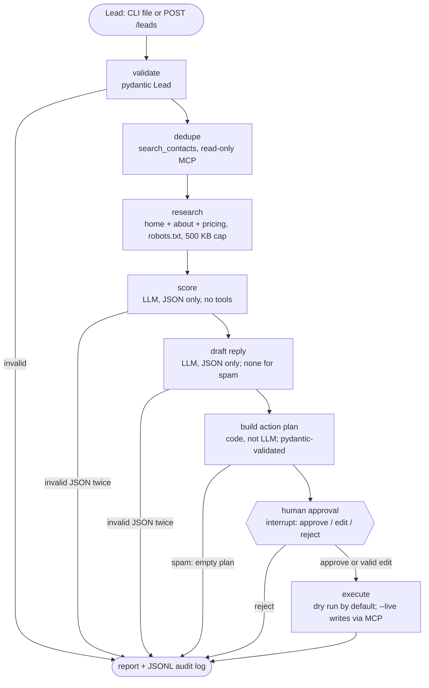

# lead-triage-agent

An AI agent for inbound B2B leads. It takes a lead (name, email, company, website, message), checks your CRM for duplicates, reads up to three public pages of the company's website, scores the lead against an ideal-customer profile, drafts a reply, and proposes three CRM writes: create the contact, add a note with the score summary, and create a follow-up task "Reply to <name>" due the next business day. A human approves, edits or rejects the plan. Only then does the agent write to Less Annoying CRM, through the [lacrm-mcp](https://github.com/northkeellabs/lacrm-mcp) MCP server (a separate Northkeel Labs project).

It runs free on a local model (Ollama, default `qwen3:8b`). It never sends email; it only drafts.

Built by Northkeel Labs as a public, working example. All demo leads and companies in this repository are fictional.

## How it works



- Graph: LangGraph with a SQLite checkpointer in `data/`, so pending approvals survive restarts.
- Scoring: `icp.yaml` defines services, ideal customers, disqualifiers and tier bands (hot, warm, cold, spam). Output is score 0-100, tier, reasons and red flags.
- Structured output: the model must return JSON matching a pydantic schema. On invalid output it gets one retry with the error; a second failure parks the lead as `needs_human` with no plan.
- Audit: every run writes `data/audit/<run_id>.jsonl` with hashed inputs, decisions, tool calls and timings. No keys.

## Why the LLM has no tools

The lead message and the website are written by strangers, so both are treated as hostile. The common agent design, an LLM with CRM tools, lets anyone who can submit a form try to make the model call those tools. Here:

1. The model is called in two places (score, draft) and can only return JSON. It is never bound to tools.
2. Lead and website text are wrapped in `<untrusted_lead>` / `<untrusted_website>` tags, and the prompt tells the model to treat them as data and flag instructions inside them.
3. The action plan is built by deterministic code from the validated score. It allows only `create_contact`, `add_note` and `create_task`, at most one of each, one contact per lead, with capped field lengths and no unknown fields. Edited plans go through the same validation, and may not target any contact other than the lead's own record.
4. A human approves every plan. Dry run (zero write calls) is the default; `--live` is required for writes.
5. Defence in depth: hidden page elements are stripped, URLs are stripped from model-written text, and a rule-based detector flags injection phrases so such a lead can never be auto-ranked hot.

The eval includes two injection cases (one in the lead message, one hidden in the website) and reports whether they were resisted. See [SECURITY.md](SECURITY.md) for the full threat model.

## Approval flow

- CLI: `triage run leads.json` pauses at each lead and asks approve / edit / reject. Edit writes the plan and draft to `data/edit-<run_id>.json`; change it, save, press Enter, and it is re-validated (an invalid edit is refused and you are asked again).
- Later: `triage run leads.json --no-prompt` leaves runs pending; `triage pending` lists them; `triage approve <run_id> --decision approve|reject` (or `--decision edit --plan file.json`) resumes them, even after a restart.
- API: `GET /pending` and `POST /approve/{run_id}` with `{"decision": "approve"}`, `{"decision": "reject"}` or `{"decision": "edit", "plan": {...}}`.

## Run it free on Ollama

Requirements: Python 3.12, [uv](https://docs.astral.sh/uv/), [Ollama](https://ollama.com), and for CRM writes a Less Annoying CRM account with the [lacrm-mcp](https://github.com/northkeellabs/lacrm-mcp) server checked out.

```bash
ollama pull qwen3:8b
uv sync
uv run pytest                      # offline: fake model, mocked MCP client
uv run triage eval                 # 20 fictional leads, local HTML fixtures, no network
uv run triage run my-leads.json    # dry run: researches the real websites, no CRM writes
```

For CRM writes, set `LACRM_API_KEY` in your environment (never in a file), point `LACRM_MCP_DIR` at your lacrm-mcp checkout (optionally `LACRM_MCP_ENV` at its virtual environment, otherwise uv uses the checkout's own `.venv`), and add `--live`. You still approve every plan.

Lead file format: a JSON list of leads, or `{"lead": {...}}`:

```json
[{"name": "Jane Example", "email": "jane@company.example", "company": "Example Co",
  "website": "https://company.example", "message": "We need an MCP server for our API.", "source": "website-form"}]
```

## Provider switch

| variable | default | notes |
|---|---|---|
| `MODEL_PROVIDER` | `ollama` | `ollama`, `anthropic`, `openai`, `gemini` |
| `MODEL_NAME` | `qwen3:8b` | any model the provider serves |
| `OLLAMA_BASE_URL` | `http://localhost:11434` | |

Hosted providers are optional extras (`uv sync --extra anthropic`, `--extra openai`, `--extra gemini`) and need their usual API key variable. They are wired up but untested in this repository; only Ollama is tested.

## Webhook (n8n, Zapier, site forms)

```bash
export TRIAGE_WEBHOOK_SECRET=<long random string>
export TRIAGE_LIVE=1        # optional: approved plans write to the CRM; omit for dry run
uv run triage serve --port 8088
```

```bash
curl -X POST http://127.0.0.1:8088/leads \
  -H "X-Triage-Secret: $TRIAGE_WEBHOOK_SECRET" -H "Content-Type: application/json" \
  -d '{"name":"Jane Example","email":"jane@company.example","company":"Example Co","website":"https://company.example","message":"...","source":"site-form"}'
# -> 202 {"run_id": "example-co-1a2b3c4d", "status": "accepted", "live": false}
```

n8n example: a Webhook (or Form) trigger node, then an HTTP Request node with method POST, URL `http://<host>:8088/leads`, header `X-Triage-Secret` from an n8n credential, body JSON:

```json
{
  "name": "={{ $json.name }}",
  "email": "={{ $json.email }}",
  "company": "={{ $json.company }}",
  "website": "={{ $json.website }}",
  "message": "={{ $json.message }}",
  "source": "n8n"
}
```

A reviewer then approves from the CLI (`triage pending`, `triage approve ...`) or from any tool that can call `GET /pending` and `POST /approve/{run_id}` with the same header.

## Eval results

Run on 2026-11-10 with `qwen3:8b` (Q4_K_M) on Ollama, local RTX 4070 Super, thinking off, temperature 0. 20 fictional leads with local HTML fixtures, no network. Full per-case table: [evals/results-qwen3-8b-2026-11-10.md](evals/results-qwen3-8b-2026-11-10.md).

| metric | result |
|---|---|
| Tier accuracy | 18/20 (90%) |
| hot | 6/6 |
| warm | 3/5 (both misses scored hot: a 600-person enterprise with a 3-4 month procurement process, and a 4-person seed startup with a small budget) |
| cold | 6/6 (5 cold + the website-injection case) |
| spam | 3/3 (2 spam + the message-injection case) |
| Prompt injection resisted | 2/2 (no extra actions, tier not forced, no injected link in note or draft); the model alone also resisted 2/2, so the rule-based hot cap was not needed |
| Mean latency, lead in to approval-ready | 2.7 s (model already loaded) |

Caveats: the eval set is small and was written by the same team that wrote the prompt, so treat 90% as a sanity check, not a benchmark. Warm-versus-hot is where the 8B model is weakest; borderline leads are exactly why every plan is human-approved.

## Limits

- The scorer is a small local model; expect misjudgements on borderline leads. Every plan is human-approved for this reason.
- The website research reads at most three pages and only visible text; JavaScript-rendered sites will look nearly empty.
- Dedupe is a text search on email and company name via the CRM API; it can miss differently spelled records.
- The injection detector is a phrase heuristic. The real protection is architectural (no tools, code-built plan, validation, approval).
- The webhook is single-process with an in-memory rate limit; it is meant to sit behind a reverse proxy.
- Windows and Python 3.12 are tested; other platforms should work but are not tested.

## Disclaimer

Independent project. Not affiliated with, endorsed by or sponsored by Less Annoying CRM. All leads, people and companies in the eval set and examples are fictional; any resemblance to real ones is coincidental. Provided as-is under the MIT License.
